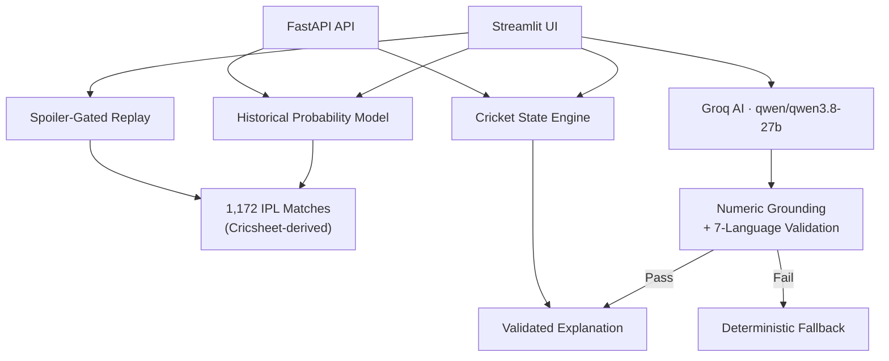

# StayUp Cricket 🏏

**An AI-powered companion for the fan who joins a T20 chase midway.**

> *"Is this chase still alive?"* — the one question every fan asks when they tune in late.

StayUp Cricket answers it instantly. Enter the current score, get historical win probabilities grounded in 1,172 IPL matches, and replay past chases ball-by-ball — all without needing a live feed.

[](https://www.python.org/downloads/)
[](LICENSE)
[](.github/workflows/tests.yml)

---

## The Fan Problem

When you tune into a T20 chase halfway through, the broadcast shows the score but rarely tells you **what it means**. Is 112/3 after 13.2 overs in a chase of 189 comfortable or desperate? How often do teams win from here? What did similar chases look like?

StayUp Cricket solves this by giving fans an instant, grounded read on any chase — without requiring a live score feed.

## What It Does

| Feature | Description |
|---|---|
| **Live Chase Analysis** | Enter `112/3 13.2 t189` → get the exact equation, both sides' win chances, side-explicit verdict, and what comparable chases did next |
| **Spoiler-Free Replay** | Step through 15 real IPL matches ball-by-ball. Future scores, turning points, and results stay hidden until reached |
| **AI Match Explanations** | Optional Groq-powered explanations with strict numeric grounding across 7 languages (English, Hindi, Hinglish, Bengali, Telugu, Tamil, Kannada) |
| **Matchup Analysis** | Batter vs bowler head-to-head from historical data |
| **Model Transparency** | Full backtest results, calibration tables, and baseline comparisons visible in-app |

## Architecture



**Key design decisions:**
- Python computes all score facts server-side — the AI only selects among pre-approved evidence IDs and writes constrained prose
- Every number in AI output is validated against supplied facts (Arabic digits, Indic numerals, spelled-out words, and compound phrases like "one hundred and five")
- Invalid AI output falls back to deterministic server-owned wording, always labelled
- Model uses walk-forward temporal calibration — training only on data through 2023, tested on 2024–2026

## Quick Start

```bash
# Clone and install
python -m venv .venv
.\.venv\Scripts\Activate.ps1          # Windows PowerShell
# source .venv/bin/activate            # macOS/Linux
pip install -r requirements.txt

# Run the app
streamlit run streamlit_app.py
```

Open `http://localhost:8501`. Core features work without an AI key. To enable AI explanations, set `GROQ_API_KEY` as an environment variable or Streamlit secret.

## Deploy to Streamlit Community Cloud

1. Push to a GitHub repository
2. Open [share.streamlit.io](https://share.streamlit.io/) → **Create app** → select this repo
3. Set entrypoint to `streamlit_app.py`, Python 3.12
4. Add secrets in the app's private settings:

```toml
AI_ENABLED = "true"
GROQ_API_KEY = "your-groq-api-key"
AI_DAILY_BUDGET = "100"
APP_DB_PATH = "/tmp/stayup_state.sqlite3"
```

## Project Structure

```
├── streamlit_app.py          # Main Streamlit application (612 lines)
├── app/
│   ├── cricket.py            # Canonical cricket state engine
│   ├── model.py              # Historical probability lookup + replay
│   ├── ai_service.py         # Groq AI integration + numeric grounding
│   ├── budget.py             # AI rate limiting (SQLite-backed)
│   ├── explanation.py        # Deterministic fallback explanations
│   ├── localization.py       # 7-language support
│   ├── main.py               # FastAPI API (optional)
│   ├── quick_entry.py        # Score parser ("112/3 13.2 t189")
│   ├── theme.py              # Light/dark mode tokens
│   └── data/                 # Derived IPL datasets (9 files)
├── tests/                    # 115 tests (unit, integration, browser)
├── scripts/                  # Data build, model evaluation, AI verify
├── .github/workflows/        # CI pipeline with headless browser tests
└── docs/                     # Model evaluation + submission note
```

## Tests

```bash
pytest -o addopts='' -q -rs
# 115 passed, 1 warning in 70s
```

The suite covers cricket edge cases, model calibration, replay spoiler gates, multi-language numeric grounding (including compound numbers like "one hundred and five" → 105), AI fallback/kill switch, WCAG AA contrast checks, API schema validation, and headless Streamlit browser tests across desktop and mobile viewports.

## Model Performance

On 748 chase states across **208 held-out IPL matches (2024–2026)**:

| Metric | Calibrated Model | Required-Rate Baseline |
|---|---|---|
| Brier Score | **0.114** | 0.153 |
| Accuracy | **84.2%** | 83.7% |

See [`docs/AI_EVALUATION.md`](docs/AI_EVALUATION.md) for full methodology, per-checkpoint results, and calibration tables.

## Limitations

- **Historical lookup, not prediction.** Past frequency is a descriptive indicator, never a guarantee.
- **No live feed.** You enter the score manually — this is a companion tool, not a broadcast replacement.
- **First-innings estimates are weaker.** The UI warns about this explicitly rather than hiding it.
- **AI is optional.** Missing keys, provider failures, or invalid output always fall back to deterministic server-owned wording.

## Data Attribution

Derived from the [Cricsheet IPL JSON archive](https://cricsheet.org/downloads/ipl_json.zip), provided under [ODC-By 1.0](app/data/LICENSE.txt). The raw archive is not included — only compact derived datasets remain. See [`app/data/data_manifest.json`](app/data/data_manifest.json).

## License

Source code: [MIT License](LICENSE) · Derived data: [ODC-By 1.0](app/data/LICENSE.txt) by Cricsheet

*Independent prototype. Not affiliated with Dream11, Dream Sports, IPL, BCCI, or Cricsheet.*
